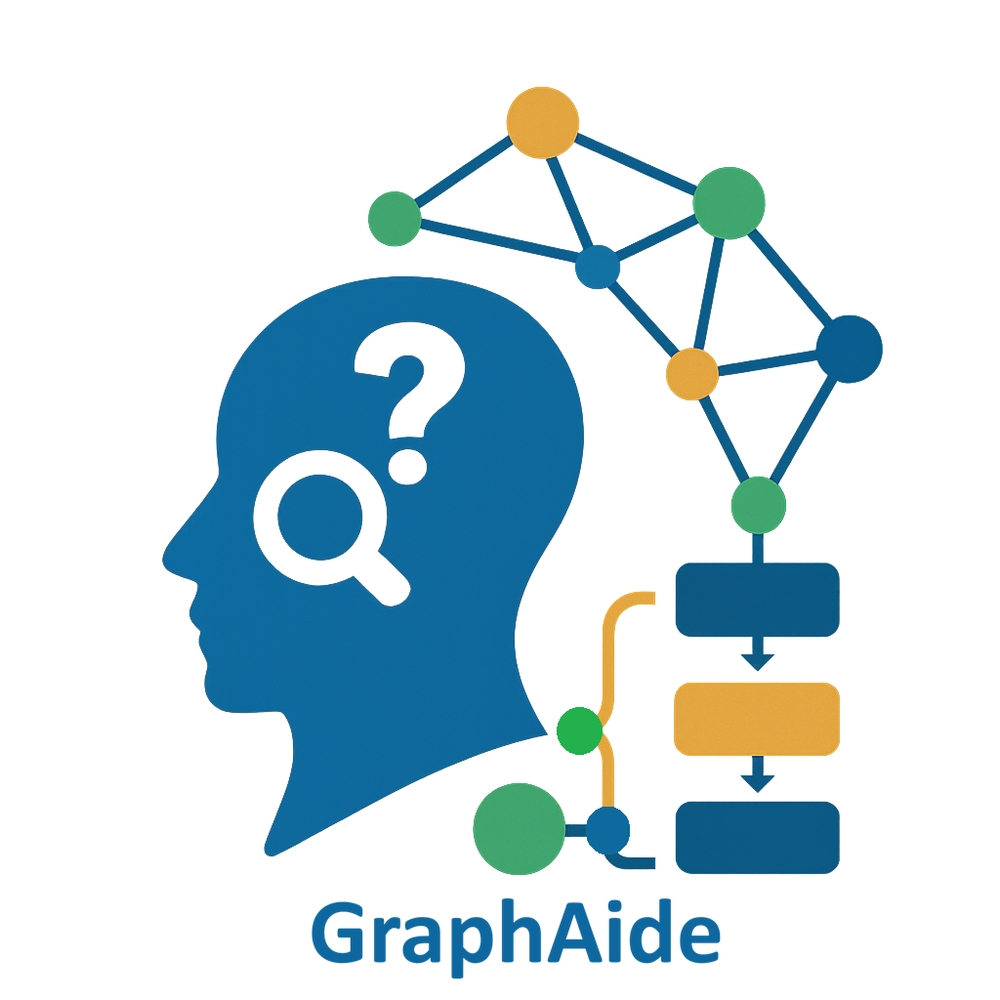

# Welcome to GraphAide

<div align="center">
  
</div>

**GraphAide** is a multi-agentic platform for building intelligent applications powered by Large Language Models (LLMs). Knowledge graph construction is one powerful example—transforming documents into queryable knowledge graphs by extracting entities and relationships. But GraphAide's capabilities extend far beyond KGs.

Whether you work with PDFs, text files, images, or web data, GraphAide can:
- **Extract** structured information and entities from any source
- **Process** diverse data with multiple LLM providers and models
- **Ground** information to external knowledge bases and sources
- **Build** intelligent workflows with minimal setup
- **Track** data provenance and attribution throughout
- **Scale** from single documents to large datasets

## Why GraphAide?

| Capability | Benefit |
|----------|---------|
| **Flexible LLM Support** | Use OpenAI, Anthropic, Google, AWS Bedrock, or local models—choose what works for you |
| **Extensible Architecture** | Build custom agents and workflows beyond KG construction |
| **Multi-Retriever RAG** | Combine multiple knowledge sources for richer, more accurate results |
| **Any Data Source** | Extract from PDFs, text, images, APIs, databases, or web data |
| **Production Ready** | Deploy as CLI, Docker, Python library, REST API, or embedded |
| **Enterprise Grade** | Track provenance, ensure compliance, audit all operations |

## Quick Start

### Basic Usage

**1. Install GraphAide:**
```bash
pip install graphaide
# Or for faster installation with uv:
# uv pip install graphaide
```

**2. Extract knowledge graph:**
```python
from graphaide import GraphAide, ModelConfig, get_sample_data_path

# Initialize GraphAide with your LLM
graphaide = GraphAide(
    model_config=ModelConfig(
        provider="openai", 
        model_name="gpt-5.6-luna",
        api_key="..."
    )
)

# Extract from sample document
sample_pdf = get_sample_data_path("PNNL_About.pdf")
sample_ontology = get_sample_data_path("ontology_cyber.nt")
result = graphaide.extract(file_path=sample_pdf, ontology_path=sample_ontology)
print(f"✓ Extracted {len(result.nodes)} entities, {len(result.edges)} relationships")
```

## Use Cases

- **Knowledge Management** — Build searchable knowledge graphs from company documents
- **Research Analysis** — Extract and connect findings across papers and reports
- **Data Integration** — Merge information from multiple sources with automatic entity linking
- **Compliance Auditing** — Track relationships and dependencies with full provenance
- **Domain Expertise** — Answer questions requiring reasoning across documents

## What You'll Learn

Start with **[Installation](installation/index.md)** to get GraphAide running, then explore:

1. **[Configuration](configuration/index.md)** — Set up models, databases, and vector stores
2. **[Extraction](extraction/index.md)** — Extract entities and relationships from documents
3. **[Ontologies](extraction/ontology.md)** — Use domain knowledge to guide extraction
4. **[Ingestion](ingestion/index.md)** — Load extracted data into Neo4j
5. **[Vector Stores](vector-stores/setup.md)** — Enhance extraction with semantic search

## Get Help

- 📖 Check [Resources](resources.md) for tutorials and examples
- 🐛 Report issues on [GitHub Issues](https://github.com/pnnl/GraphAide/issues)
- 💬 Ask questions via [GitHub Discussions](https://github.com/pnnl/GraphAide/discussions)

## Citation

If you use GraphAide in your research, please cite:

```bibtex
@inproceedings{purohit2024graphaide,
  title={GraphAide: Advanced Graph-Assisted Query and Reasoning System},
  author={Purohit, Sumit and Chin, George and Mackey, Patrick S and Cottam, Joseph A},
  booktitle={2024 IEEE International Conference on Big Data (BigData)},
  pages={3485--3493},
  year={2024},
  organization={IEEE}
}
```

## Legal

Please review the important legal documents:

- **[Legal Information](legal/)** — License, disclaimer, acknowledgment, notices

---

**Ready to build your first knowledge graph?** Start with [Installation](installation/index.md).
